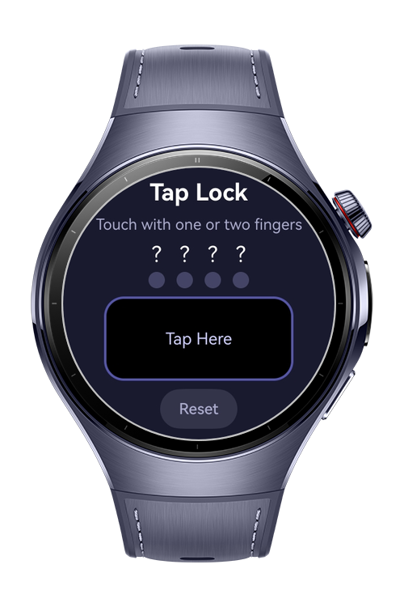
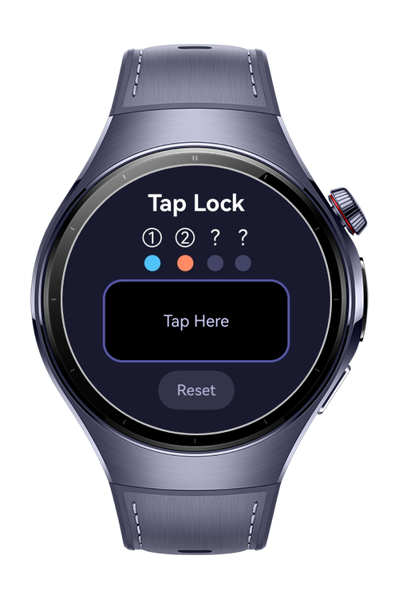
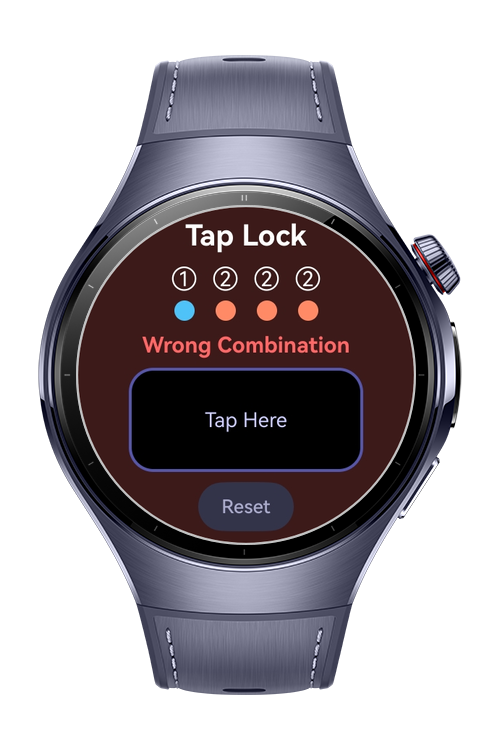
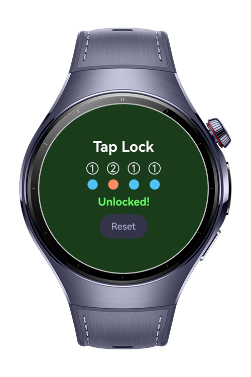

> **Note:** To access all shared projects, get information about environment setup, and view other guides, please visit [Explore-In-HMOS-Wearable Index](https://github.com/Explore-In-HMOS-Wearable/hmos-index).

# How to Build Touch Pointer Handler

The `how_to_build_touch_pointer_handler` codelab demonstrates how to use multiple touch events on smart wearables.

# Preview

<div>
  
  
  
  
</div>

# Use Cases
- **Screen lock**: Screen is locked against accidental touches and only a two-finger tap wakes it up, preventing unintended inputs during physical activity.
- **Workout controls:** single tap to pause, two-finger tap to stop the session entirely.
- **Navigation:** single tap to scroll down, two-finger tap to go back to the home screen.
- **Media playback:** single tap to play/pause, two-finger tap to skip to the next track.
- **Tap Lock:** If Tap lock 

# Tech Stack

- **Languages**: ArkTS / ArkUI
- **Frameworks**: HarmonyOS SDK 6.0.1(21)
- **Tools**: DevEco Studio(6.0.1)
- **Libraries**:
    - `@kit.ArkUI`

# Directory Structure

```
entry/src/main/
|---ets/
|   |---entryability/
|   |   |---EntryAbility.ets          
|   |---entrybackupability/
|   |   |---EntryBackupAbility.ets
|   |---pages/
|       |---Index.ets       
|---resources/
|   |---base/
|   |   |---element/
|   |   |   |---color.json            
|   |   |   |---float.json
|   |   |   |---string.json          
|   |   |---media/
|   |   |---profile/
|   |---dark/
|       |---element/
|           |---color.json            
|---module.json5                     
```

# Constraints and Restrictions

## Supported Devices

- Huawei Watch 5
- Huawei Watch Ultimate 2

# License

How to Build Touch Pointer Handler on Watch is distributed under the terms of the MIT License.
See the [LICENSE](LICENSE) for more information.